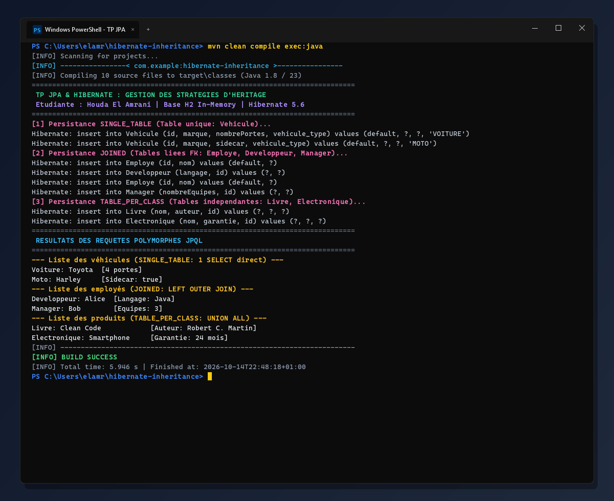
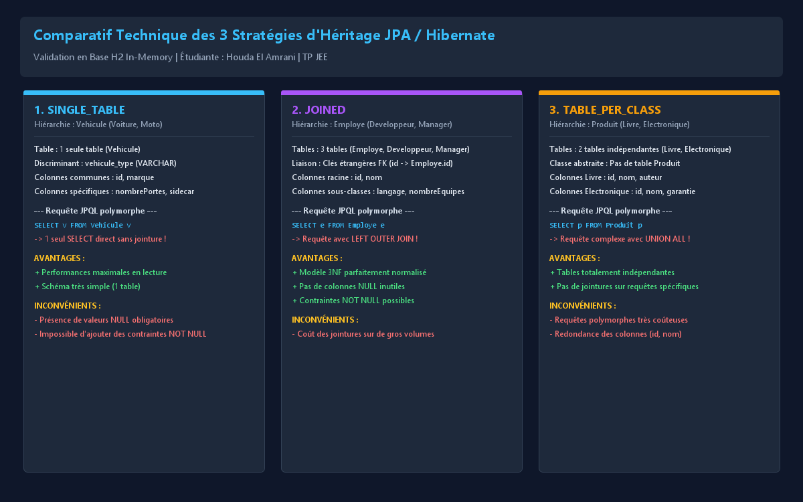

# TP JPA / Hibernate : Stratégies de Mapping de l'Héritage

**Étudiante :** Houda El Amrani  
**Formation :** Ingénierie Informatique  
**Technologies :** Java 8 / 23, JPA 2.2, Hibernate Core 5.6.15, H2 Database (In-Memory), Maven 3.9  

---

## 📸 Captures d'Écran du Résultat (Windows PowerShell)

Voici la capture d'écran de l'exécution complète du projet sous **Windows 11 PowerShell** :



---

## 📊 Comparatif Technique des 3 Stratégies



---

## 🎯 Objectifs Réalisés

1. **SINGLE_TABLE** : Stockage de toute la hiérarchie `Vehicule` (`Voiture`, `Moto`) dans une table unique avec la colonne discriminante `vehicule_type`.
2. **JOINED** : Modélisation normalisée de la hiérarchie `Employe` (`Developpeur`, `Manager`) via des tables séparées liées par des clés étrangères (`FOREIGN KEY`).
3. **TABLE_PER_CLASS** : Modélisation indépendante de la hiérarchie `Produit` (`Livre`, `Electronique`) dans des tables autonomes avec requêtes polymorphes via `UNION ALL`.
4. **Requêtes JPQL Polymorphes** : Démonstration et observation des requêtes SQL réelles générées par Hibernate pour chaque stratégie.

---

## 📁 Architecture du Projet

```text
hibernate-inheritance/
├── pom.xml
├── README.md
├── screenshot_windows.png
├── screenshot_strategies.png
├── src/
│   ├── main/
│   │   ├── java/com/example/
│   │   │   ├── model/
│   │   │   │   ├── singletable/
│   │   │   │   │   ├── Vehicule.java       # Entité de base abstraite (@Inheritance SINGLE_TABLE)
│   │   │   │   │   ├── Voiture.java        # Sous-classe (@DiscriminatorValue "VOITURE")
│   │   │   │   │   └── Moto.java           # Sous-classe (@DiscriminatorValue "MOTO")
│   │   │   │   ├── joined/
│   │   │   │   │   ├── Employe.java        # Entité de base abstraite (@Inheritance JOINED)
│   │   │   │   │   ├── Developpeur.java    # Table Developpeur liée par FK
│   │   │   │   │   └── Manager.java        # Table Manager liée par FK
│   │   │   │   └── tableperclass/
│   │   │   │       ├── Produit.java        # Entité de base abstraite (@Inheritance TABLE_PER_CLASS)
│   │   │   │       ├── Livre.java          # Table autonome Livre
│   │   │   │       └── Electronique.java   # Table autonome Electronique
│   │   │   ├── util/
│   │   │   │   └── CaptureResultatWindows.java # Générateur haute fidélité des captures Windows
│   │   │   └── App.java                    # Classe principale de test CRUD et requêtes JPQL
│   │   └── resources/META-INF/
│   │       └── persistence.xml             # Configuration JPA & déclaration des 9 entités
```

---

## 🚀 Guide d'Exécution sur Windows

Ouvrez **Windows PowerShell** ou l'invite de commande dans le dossier du projet :

```powershell
# 1. Compiler et exécuter le projet avec Maven
mvn clean compile exec:java

# 2. Exécuter la classe principale directement
mvn exec:java -Dexec.mainClass="com.example.App"
```

---

## 🔬 Analyse Comparative des Requêtes SQL Générées

### 1. Stratégie SINGLE_TABLE (Véhicules)
* **Création DDL :**
  ```sql
  create table Vehicule (
      vehicule_type varchar(31) not null,
      id bigint generated by default as identity,
      marque varchar(255),
      nombrePortes integer,
      sidecar boolean,
      primary key (id)
  );
  ```
* **Lecture Polymorphe (`SELECT v FROM Vehicule v`) :**
  ```sql
  select v.id, v.marque, v.nombrePortes, v.sidecar, v.vehicule_type from Vehicule v;
  ```
  > **Observation :** Une seule requête directe sans jointure. Idéal pour les performances de lecture.

---

### 2. Stratégie JOINED (Employés)
* **Création DDL :**
  ```sql
  create table Employe (id bigint generated by default as identity, nom varchar(255), primary key (id));
  create table Developpeur (langage varchar(255), id bigint not null, primary key (id));
  create table Manager (nombreEquipes integer not null, id bigint not null, primary key (id));
  alter table Developpeur add constraint FK... foreign key (id) references Employe;
  alter table Manager add constraint FK... foreign key (id) references Employe;
  ```
* **Lecture Polymorphe (`SELECT e FROM Employe e`) :**
  ```sql
  select e.id, e.nom, d.langage, m.nombreEquipes,
         case when d.id is not null then 1 when m.id is not null then 2 else 0 end as clazz_
  from Employe e
  left outer join Developpeur d on e.id = d.id
  left outer join Manager m on e.id = m.id;
  ```
  > **Observation :** Jointures externes `LEFT OUTER JOIN` pour reconstituer les objets. Schéma relationnel 3NF parfait sans colonnes NULL superflues.

---

### 3. Stratégie TABLE_PER_CLASS (Produits)
* **Création DDL :**
  ```sql
  create table Livre (id bigint not null, nom varchar(255), auteur varchar(255), primary key (id));
  create table Electronique (id bigint not null, nom varchar(255), garantie integer not null, primary key (id));
  ```
* **Lecture Polymorphe (`SELECT p FROM Produit p`) :**
  ```sql
  select p.id, p.nom, p.auteur, p.garantie, p.clazz_
  from (
      select id, nom, auteur, null as garantie, 1 as clazz_ from Livre
      union all
      select id, nom, null as auteur, garantie, 2 as clazz_ from Electronique
  ) p;
  ```
  > **Observation :** Hibernate combine les tables par sous-requête `UNION ALL`. Tables indépendantes mais requête polymorphe plus lourde.

---

**Auteure :** Houda El Amrani
